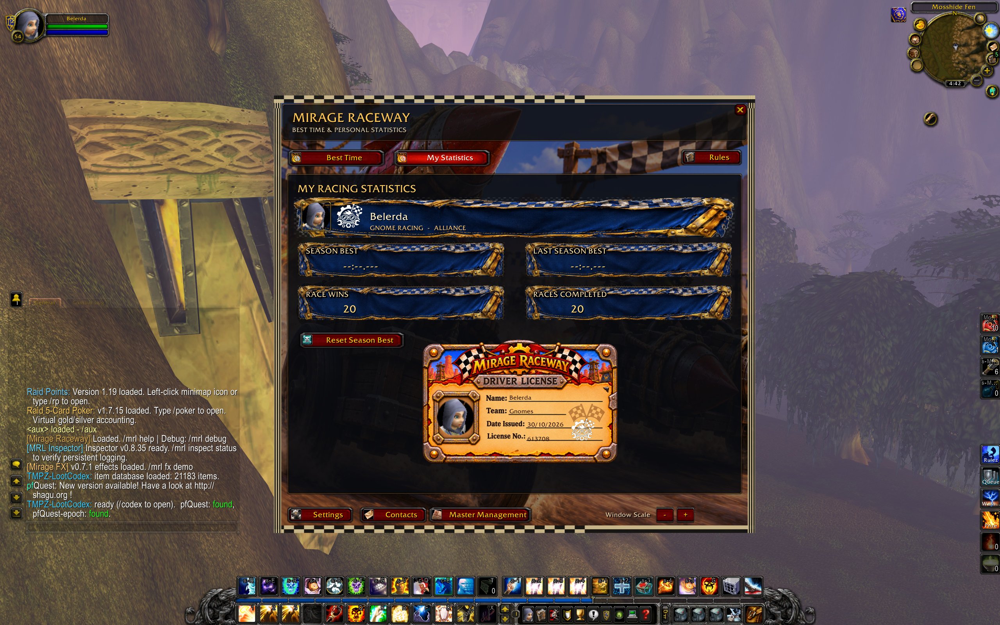
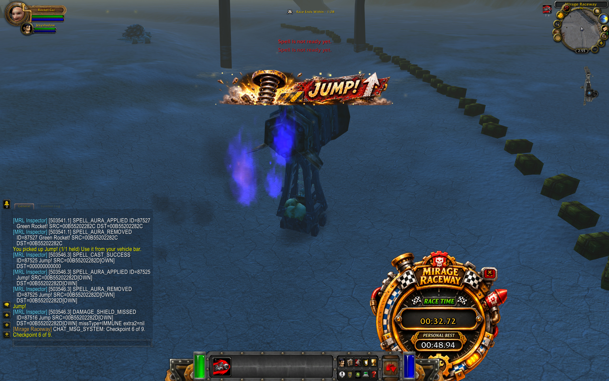
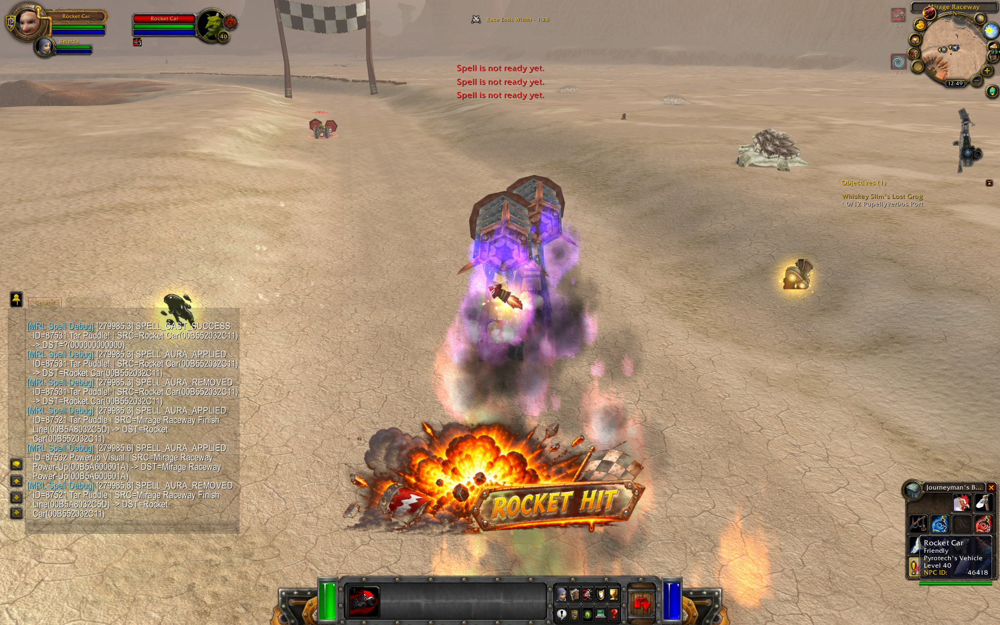

# Addon Mirage Raceway!
Version 1.2.12
Mirage Raceway Best Time is a World of Warcraft addon for Epoch Reborn that automatically tracks racing records at Mirage Raceway.
Synchronization of the leaderboard is only possible when the player Belerda is online. The automatic update interval is 120 minutes. Your records are saved locally and can be updated manually via the "Refresh" button, or automatically according to the set interval.

 
 

**Leadearboard**
Features include a Top 50 leaderboard, personal racing statistics, seasonal and previous-season best times, race results, and automatic leaderboard synchronization.

**Options**
The addon also includes racing rules, visual effects, customizable settings.

**Contacts:**
Fluxer ID 1547691390027169792.
Discord ID 1347192429404487690.
WoW Epoch Reborn /w Belerda.
OctoWoW /w Jarat.
